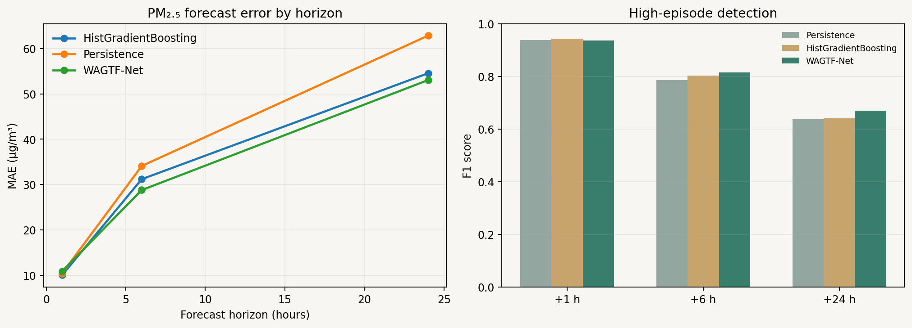
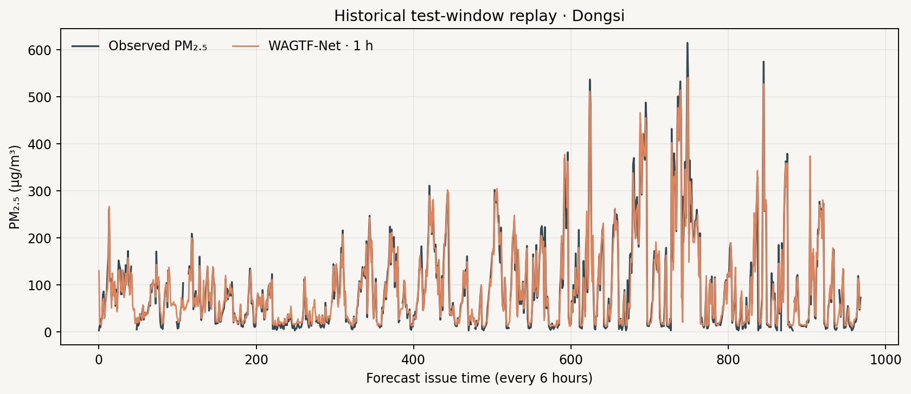
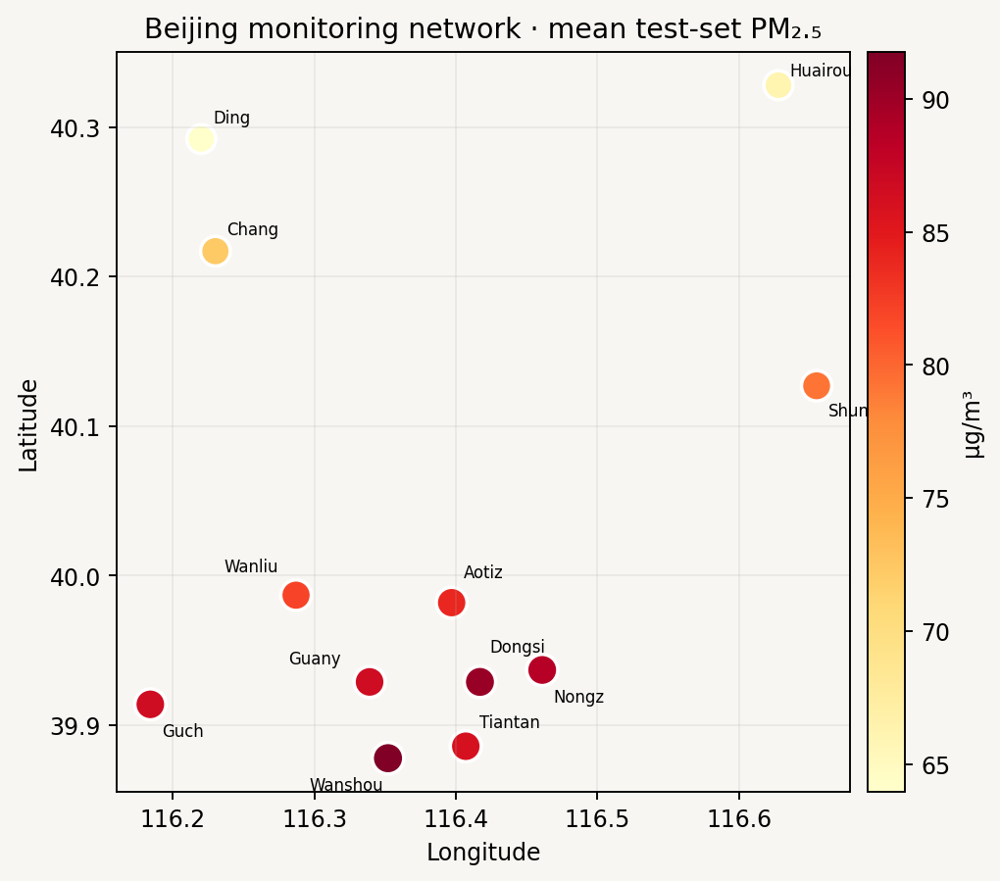

# MOSAIC-Air: Wind-Aware Spatiotemporal Forecasting for Urban Air Pollution

**Course:** 22ENV231 – Environmental Management  
**Institution:** Amrita Vishwa Vidyapeetham, Amritapuri Campus  
**Project team:** Aakash (AM.SC.U4CSE23301), Shaik Mohammed Atif (AM.SC.U4CSE23354), Shivadev (AM.SC.U4CSE23359)

## Abstract

Urban air pollution changes across both time and location, and its short-term movement is influenced by weather and local conditions. This project implements MOSAIC-Air as a reproducible pilot for forecasting PM₂.₅ at multiple monitoring stations. Its Wind-Aware Graph–Temporal Fusion Network (WAGTF-Net) combines a temporal convolutional encoder with graph attention over station locations. Attention is adjusted using source-station wind direction, wind speed, and inter-station distance. The model produces forecasts at 1-, 6-, and 24-hour horizons, P10/P50/P90 prediction quantiles, and a probability of crossing a project-defined high-pollution threshold.

The pilot uses the public UCI Beijing Multi-Site Air Quality dataset: 420,768 hourly station records from 12 sites between March 2013 and February 2017. Evaluation uses a chronological train/validation/test split and compares the model with persistence and a HistGradientBoosting baseline. In the held-out period, WAGTF-Net improves MAE over HistGradientBoosting at 6 hours (28.80 versus 31.19 µg/m³) and 24 hours (53.02 versus 54.53 µg/m³). At 1 hour, the gradient-boosted baseline has lower MAE (10.07 versus 10.92 µg/m³), while WAGTF-Net has lower RMSE. An additional test with 20% of observed PM₂.₅ input values randomly masked shows a large one-hour error increase, which highlights the need for stronger missing-data handling before deployment. A local FastAPI service and browser dashboard provide a historical replay of station forecasts, episode probabilities, uncertainty intervals, and emerging hotspots. The results support further study of wind-conditioned spatial learning while showing that performance depends on horizon and input completeness.

**Keywords:** PM₂.₅, air-quality forecasting, graph attention, wind-conditioned learning, multi-horizon forecasting, uncertainty, environmental decision support.

## 1. Introduction

Air pollution is a management problem because pollutant concentration, population exposure, weather, and monitoring coverage vary across a city. A citywide average can conceal local episodes. Short-term forecasts could help environmental teams decide where to inspect readings, communicate changing conditions, or focus limited monitoring resources. Such outputs must communicate uncertainty and should be checked against trusted monitoring data.

Many time-series approaches model temporal patterns but represent inter-station relationships only weakly. MOSAIC-Air studies whether a lightweight station graph, conditioned on wind, can improve multi-horizon PM₂.₅ forecasts and episode detection. The supplied abstract describes a general framework; this implementation makes the project concrete with a public Beijing dataset and a local, reproducible prototype.

## 2. Aim, objectives, and research questions

**Aim:** Build and evaluate a wind-aware multi-station PM₂.₅ forecasting prototype that communicates short-term pollution risk and uncertainty.

**Objectives:**

1. Prepare an hourly multi-site pollution/weather panel with reproducible, leakage-conscious handling of missing data.
2. Implement WAGTF-Net with temporal convolutions, coordinate-based graph attention, and wind-conditioned edge weighting.
3. Forecast PM₂.₅ at 1, 6, and 24 hours and jointly estimate quantiles and high-episode probability.
4. Compare against persistence and a conventional machine-learning baseline using a chronological holdout.
5. Expose forecasts through a REST API and a location-oriented browser view.

**Research questions:**

- RQ1: Does WAGTF-Net improve multi-horizon PM₂.₅ error over simple temporal and tabular baselines?
- RQ2: How well do its episode probabilities and prediction intervals describe high-pollution conditions and forecast uncertainty?
- RQ3: How sensitive are its forecasts to additional missing PM₂.₅ input values?

## 3. Data and study area

The benchmark is the UCI Beijing Multi-Site Air Quality dataset. It contains 420,768 hourly observations from 12 nationally controlled monitoring sites from 1 March 2013 through 28 February 2017. The dataset includes PM₂.₅, PM₁₀, SO₂, NO₂, CO, O₃, temperature, pressure, dew point, precipitation, wind direction, and wind speed. UCI notes that observations can be missing and that site-level meteorological data are matched to nearby weather stations [1].

Coordinates were added from published Beijing station tables because the benchmark CSV contains station names but no site coordinates [3]. The values in `src/stations.json` are approximate and are used only for pilot graph distances and visualization. The input weather observations are those supplied with the benchmark; no external weather archive or live air-quality feed is used.

### Study scope

This is a Beijing temporal backtest, not an Amritapuri or Indian-city deployment. The results show whether the proposed method is technically feasible on a well-known multi-site benchmark. Local decision support would require local monitoring data, station metadata, regulatory context, validation, and consultation with environmental and public-health authorities.

## 4. Methodology

### 4.1 Preprocessing

Records are aligned to an hourly grid for each station. Wind directions are represented with sine and cosine features. Input features are forward-filled causally for up to three hours; longer gaps are imputed using the training-period median. Missingness indicators are retained. Means and standard deviations are fit on training-period inputs only and then reused for validation and test data. PM₂.₅ targets are not imputed for training or evaluation; missing target values are masked out of the loss and metrics.

Each sample uses the previous 24 hours across all 12 stations. Training examples are issued every six hours to reduce overlap; validation and test use the same six-hour interval. Forecast targets are +1, +6, and +24 hours.

### 4.2 Chronological split

| Split | Period | Use |
|---|---|---|
| Training | 1 Mar 2013 – 31 Dec 2015 | Fit model parameters and feature scaling |
| Validation | 1 Jan 2016 – 30 Jun 2016 | Early stopping and event-threshold selection |
| Test | 1 Jul 2016 – 28 Feb 2017 | Final reported metrics |

No random time split is used. This preserves the forecasting direction and prevents future observations from entering model fitting. Test sample counts differ slightly by horizon because missing target observations are excluded.

### 4.3 WAGTF-Net architecture

WAGTF-Net has four stages:

1. **Temporal encoding:** shared 1-D convolutions summarize the 24-hour sequence at each station.
2. **Spatial encoding:** multi-head graph attention passes information among station representations. Pairwise distance contributes a static bias. For each source station, the model compares the bearing to each destination with the measured downwind direction (wind direction plus 180°) and uses wind speed to adjust the attention score. Edges beyond 100 km are masked.
3. **Adaptive fusion:** temporal and graph representations are concatenated and fused through a compact multilayer block.
4. **Multi-task output:** for each horizon, the model estimates P10/P50/P90 concentration and a high-episode logit. Quantile ordering is enforced around the median. Training combines pinball loss with a weighted binary cross-entropy loss.

The model is trained with AdamW, fixed seed 23, early stopping on validation MAE, and a maximum of 12 epochs. The event threshold is PM₂.₅ ≥ 75 µg/m³, chosen as a project benchmark. It is not presented as a health guideline or a regulatory conclusion. The event-probability cutoff is selected using validation data for each horizon, then frozen before test evaluation.

### 4.4 Baselines

- **Persistence:** the latest available PM₂.₅ input is used for all forecast horizons.
- **HistGradientBoosting:** a shared histogram gradient-boosted regressor uses recent PM₂.₅ lags, contemporaneous pollutant and weather features, cyclic time features, and station identity. It is trained separately for each horizon.

For event F1, the baseline concentration cutoff is selected on validation data; WAGTF-Net's event-probability cutoff is selected on the same period. The ground-truth episode definition remains 75 µg/m³ for every model.

### 4.5 Metrics and missingness stress

Forecast performance is measured with MAE, RMSE, and R². Episode classification is measured with F1 and Brier score. Quantile uncertainty is summarized by P10–P90 empirical coverage and interval width. A nominal 80% interval should have coverage near 0.80 over repeated comparable cases; coverage alone does not guarantee useful calibration at every station or horizon.

For the missingness stress experiment, the trained model is unchanged. In the held-out input window, an additional random 20% of originally observed PM₂.₅ values is masked, the corresponding missingness flags are set, and forecasts are recalculated. This tests input sensitivity, not a full sensor outage or a new-city scenario.

## 5. System implementation

The training pipeline is implemented in Python with NumPy, pandas, scikit-learn, and PyTorch. The FastAPI service loads the trained model and preprocessed benchmark. `/api/metadata` returns site locations, replay period, and forecast horizons; `/api/forecast` returns a forecast for a selected historical issue time; `/api/health` reports service state.

The browser dashboard presents a station map, forecast horizon selector, site-level median and prediction interval, episode probability, weather context, and a ranked hotspot list. It is explicitly labeled a historical replay. For operational forecasting, the data ingestion layer would need to supply current pollutant observations and forecast weather over the prediction horizon; the present app does not do that.

## 6. Results

### 6.1 Held-out forecast and episode performance

| Horizon | Model | MAE (µg/m³) | RMSE (µg/m³) | R² | Episode F1 |
|---:|---|---:|---:|---:|---:|
| 1 h | Persistence | 10.44 | 20.36 | 0.948 | 0.938 |
| 1 h | HistGradientBoosting | **10.07** | 19.39 | 0.953 | **0.943** |
| 1 h | WAGTF-Net | 10.93 | **18.46** | **0.957** | 0.936 |
| 6 h | Persistence | 34.11 | 59.07 | 0.567 | 0.786 |
| 6 h | HistGradientBoosting | 31.19 | 52.56 | 0.657 | 0.803 |
| 6 h | WAGTF-Net | **28.80** | **49.78** | **0.692** | **0.815** |
| 24 h | Persistence | 62.82 | 94.66 | -0.112 | 0.637 |
| 24 h | HistGradientBoosting | 54.53 | 80.05 | 0.204 | 0.640 |
| 24 h | WAGTF-Net | **53.03** | **78.55** | **0.234** | **0.669** |

WAGTF-Net is strongest at the 6-hour horizon in this experiment, with MAE about 7.7% lower than HistGradientBoosting. It makes a smaller improvement at 24 hours (about 2.8% lower MAE). At one hour, HistGradientBoosting has the lowest MAE and highest event F1, while WAGTF-Net has the lowest RMSE and highest R². Thus the pilot does not support a claim that graph attention wins at every horizon.

### 6.2 Uncertainty and event probabilities

WAGTF-Net's held-out event Brier scores are 0.039, 0.112, and 0.203 at 1, 6, and 24 hours. P10–P90 empirical coverage is 0.824, 0.840, and 0.804. Coverage is close to the nominal 0.80 overall, but the mean interval width grows from 36.68 µg/m³ at one hour to 155.22 µg/m³ at 24 hours. The 24-hour forecast is therefore substantially less precise even though its aggregate interval coverage is close to nominal.

### 6.3 Additional missing-input experiment

| Horizon | Standard WAGTF MAE | With additional 20% PM₂.₅ input missing | Change |
|---:|---:|---:|---:|
| 1 h | 10.93 | 17.88 | +63.6% |
| 6 h | 28.80 | 32.70 | +13.6% |
| 24 h | 53.03 | 53.45 | +0.8% |

One-hour forecasts depend strongly on recent PM₂.₅ observations. The missingness flags help the model recognize absent values but do not prevent near-term performance loss. Missingness stress coverage is 0.684, 0.781, and 0.795 for the respective horizons, so the one-hour intervals are also less reliable under this perturbation.

### 6.4 Figures

## 7. Discussion and environmental management relevance

The results suggest that wind-conditioned station attention is most useful at the medium forecast horizon in this benchmark. At one hour, persistence and tabular gradient boosting already capture much of the short-term continuity. At 24 hours, all models have substantially higher errors and WAGTF-Net's intervals become wide. A project prototype should therefore report horizon-specific skill instead of presenting a single accuracy figure.

For environmental management, a map of station-level forecasts can help direct attention toward emerging local peaks. Episode probability supports risk triage, while uncertainty intervals show when predictions are too broad for a confident interpretation. The tool should be treated as an additional screening layer. Staff should verify an alert against monitoring station readings and local procedures before acting.

## 8. Limitations

1. **Geographic coverage:** all evaluation sites are in Beijing, and every site appears in training. The study tests time-forward performance, not transfer to an unseen station or city.
2. **Historical period:** observations end in February 2017. The dashboard is a replay and cannot provide current conditions.
3. **Weather at inference:** the benchmark supplies historical station weather. A live forecast requires future weather inputs and a validated pipeline for joining them to pollutant observations.
4. **Coordinates:** approximate site coordinates were transcribed from literature and require confirmation with the monitoring authority.
5. **Wind transport:** a station-level wind vector and distance-based graph simplify complex terrain, boundary-layer dynamics, chemical reactions, and local emissions. Learned attention is not a causal transport model.
6. **Missingness:** a random 20% PM₂.₅ input perturbation sharply reduced 1-hour accuracy. Systematic outages, sensor drift, and missing weather were not tested.
7. **Episode threshold:** 75 µg/m³ is a project-defined binary label for this experiment, not a health recommendation.
8. **Uncertainty:** aggregate interval coverage can hide station-specific miscalibration; more calibration and subgroup analysis are needed.

## 9. Future work

- Replace the Beijing benchmark with a locally relevant, quality-checked dataset and test transfer across held-out stations.
- Join pollutant monitors with archived and forecast meteorology; validate wind direction conventions and spatial alignment.
- Add missingness augmentation and outage-specific evaluation, particularly for one-hour predictions.
- Use rolling-origin backtests and compare against seasonal, persistence, and temporal deep-learning baselines.
- Calibrate quantiles per station and horizon and evaluate event precision/recall under management-relevant costs.
- Deploy a monitored API only after validating data freshness, model drift, uncertainty, and escalation procedures with environmental stakeholders.

## 10. Conclusion

MOSAIC-Air demonstrates an end-to-end path from a multi-station environmental time series to probabilistic forecasts, hotspot communication, and a local API. On the Beijing benchmark, WAGTF-Net improves six-hour and 24-hour MAE against the selected baselines, but it does not lead on all one-hour metrics and is sensitive to additional missing recent PM₂.₅ observations. These results make the framework a useful course-project prototype and define the next validation work required before environmental operations use.

## References

1. Chen, S. (2017). *Beijing Multi-Site Air Quality* [Dataset]. UCI Machine Learning Repository. <https://doi.org/10.24432/C5RK5G>.
2. Zhang, S., Guo, B., Dong, A., He, J., Xu, Z., & Chen, S. (2017). Cautionary tales on air-quality improvement in Beijing. *Proceedings of the Royal Society A, 473*(2205), 20170457. <https://doi.org/10.1098/rspa.2017.0457>.
3. Tsokov, S., Lazarova, M., & Aleksieva-Petrova, A. (2022). A hybrid spatiotemporal deep model based on CNN and LSTM for air pollution prediction. *Sustainability, 14*(9), 5104. <https://doi.org/10.3390/su14095104>.
